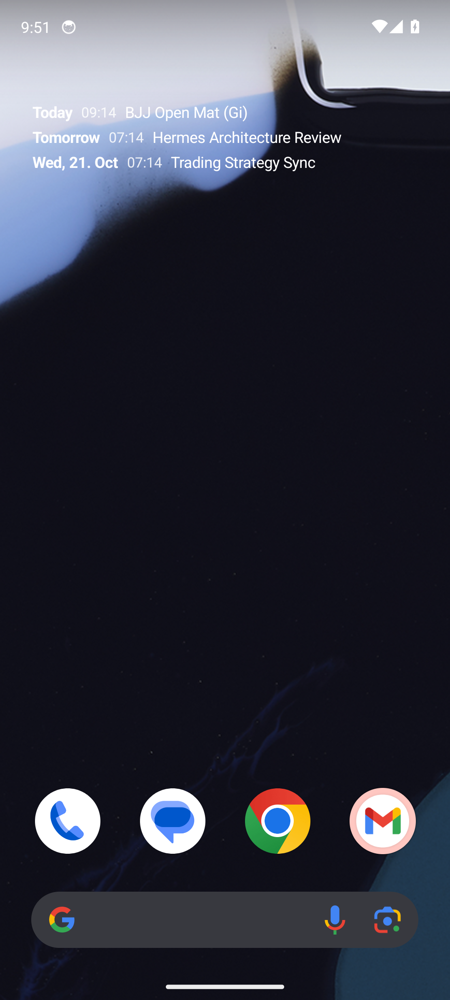
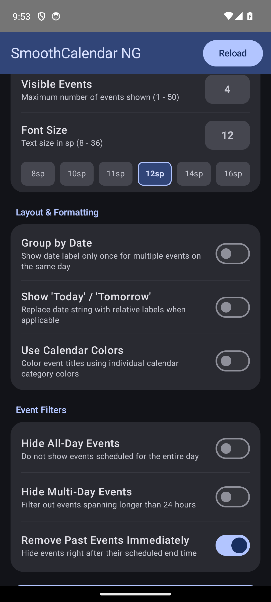

# SmoothCalendar NG

[](https://www.gnu.org/licenses/agpl-3.0)
[](https://kotlinlang.org)
[](https://developer.android.com/jetpack/androidx/releases/glance)
[](https://developer.android.com)

A modern, ultra-minimalist, transparent Android calendar widget built with **Jetpack Glance** (Compose for AppWidgets). Re-engineered as the modern successor to the legendary **Smooth Calendar** – built for simplicity, zero battery drain, and seamless home screen integration.

---

## Preview

| Transparent Widget on Dark Wallpaper | In-App Configuration |
| :---: | :---: |
|  |  |

---

## Features

* **True 100% Transparency:** Blends completely into your desktop wallpaper. Background opacity adjustable from 0% (fully transparent) to 100% solid.
* **Pixel-Perfect Alignment:** All-day events and timed events align naturally without jumping columns or messy borders.
* **Instant Settings Access:** Tapping the widget opens configuration immediately, just like classic Smooth Calendar.
* **Adaptive Material You Icon:** Sage green palette (`#A7BEAD`) with full monochrome themed icon support on Android 13+.
* **Flexible Filtering:**
  * Configurable lookahead window (e.g. 14 days) and item count cap.
  * Toggle options to hide all-day events or multi-day spanning events.
  * Auto-eviction: past events disappear automatically once their end time has passed (`removeOnEnd`).
  * Support for individual calendar exclusions.
* **Zero Telemetry & Minimal Permissions:**
  * Only requests read access to calendar instances (`android.permission.READ_CALENDAR`).
  * No network permissions (`INTERNET` permission is absent).
  * Zero ads, zero tracking, zero background battery waste.
* **Ultra-Lightweight:** Fully optimized with R8/ProGuard and resource shrinking down to just **2.5 MB**.

---

## Installation & Updates

### Obtainium (Recommended)
SmoothCalendar NG works seamlessly with [Obtainium](https://github.com/ImranR98/Obtainium) for automatic background updates directly from GitHub Releases:
1. Open **Obtainium** on your Android device.
2. Tap **Add App** and paste: `https://github.com/t4c/smoothcalendar-ng`
3. Tap **Add** – Obtainium tracks new release tags and installs APK updates directly.

### Manual Download
Download the latest `SmoothCalendar-NG.apk` directly from the [GitHub Releases](https://github.com/t4c/smoothcalendar-ng/releases) page.

---

### Build Commands

```bash
# Clone the repository
git clone https://github.com/t4c/smoothcalendar-ng.git
cd smoothcalendar-ng

# Build Release APK
./gradlew assembleRelease

# Output APK path:
# app/build/outputs/apk/release/SmoothCalendar-NG.apk
```

---

## License

SmoothCalendar NG is Free Software licensed under the **GNU Affero General Public License v3.0 (AGPL-3.0-or-later)**. See the [LICENSE](LICENSE) file for the full license text.

---

## Support

If you like this project, you can buy me a coffee:

[](https://buymeacoffee.com/t4c2)
