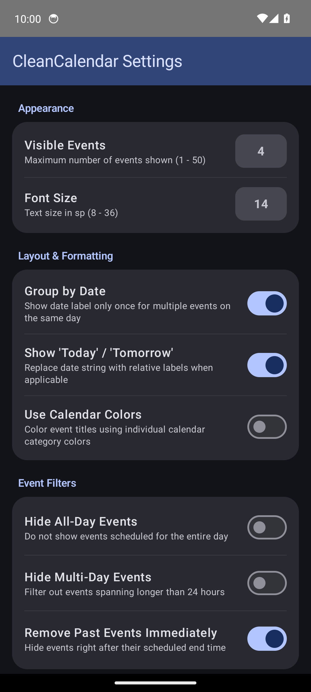

# CleanCalendar

[](LICENSE)
[](https://kotlinlang.org)
[](https://developer.android.com/jetpack/androidx/releases/glance)
[](https://developer.android.com)

A modern, ultra-minimalist, transparent Android calendar widget built with **Jetpack Glance** (Compose for AppWidgets). Inspired by the legendary **Smooth Calendar**, engineered for simplicity, zero battery drain, and seamless home screen integration.

---

## Preview

| Transparent Widget on Dark Wallpaper | In-App Configuration |
| :---: | :---: |
|  |  |

---

## Features

* **True 100% Transparency:** Blends completely into your desktop wallpaper. Background opacity adjustable from 0% (fully transparent) to 100% solid.
* **Date Grouping:** Events occurring on the same day group cleanly under a single date label without visual clutter.
* **Relative Labels:** Highlights events for "Today" and "Tomorrow" dynamically.
* **Instant Action Routing:**
  * Tapping any specific event opens that exact appointment in your default Android calendar app.
  * Tapping empty widget space opens the calendar at the current time.
* **Flexible Filtering:**
  * Configurable lookahead window (e.g. 14 days) and item count cap (default: 4 events).
  * Toggle options to hide all-day events or multi-day spanning events.
  * Auto-eviction: past events disappear automatically once their end time has passed (`removeOnEnd`).
  * Support for individual calendar exclusions.
* **Zero Telemetry & Minimal Permissions:**
  * Only requests read access to calendar instances (`android.permission.READ_CALENDAR`).
  * No network permissions (`INTERNET` permission is absent).
  * Zero ads, zero tracking, zero background battery waste.
* **Material 3 Configuration App:**
  * Fast, native Jetpack Compose configuration UI to tweak appearance, numeric event limits, font sizes, date formats, and filters on the fly.
  * Organic Material 3 grouped card hierarchy with native pill inputs matching system switches.
  * Instant preference synchronization powered by AndroidX DataStore.

---

## Architecture & Tech Stack

CleanCalendar is architected with modern Android engineering best practices:

* **Jetpack Glance (`androidx.glance:glance-appwidget:1.1.1`):** Declarative widget layout rendering translating Compose trees directly into RemoteViews.
* **Android Calendar Provider (`CalendarContract.Instances`):** Efficient instance querying with projection pruning to maximize read speeds and reduce memory footprint.
* **AndroidX DataStore (`Preferences`):** Reactive, type-safe persistence for widget preferences.
* **Jetpack Compose + Material 3:** Modern, accessible user interface for the in-app settings screen.

---

## Building from Source

### Prerequisites
* JDK 17 or higher
* Android SDK Platform 35 (`compileSdk = 35`, `minSdk = 26`)

### Build Commands

```bash
# Clone the repository
git clone https://github.com/t4c/cleancalendar.git
cd cleancalendar

# Build Debug APK
./gradlew assembleDebug

# Output APK path:
# app/build/outputs/apk/debug/app-debug.apk
```

---

## License

```text
Copyright 2026 t4c

Licensed under the Apache License, Version 2.0 (the "License");
you may not use this file except in compliance with the License.
You may obtain a copy of the License at

    http://www.apache.org/licenses/LICENSE-2.0

Unless required by applicable law or agreed to in writing, software
distributed under the License is distributed on an "AS IS" BASIS,
WITHOUT WARRANTIES OR CONDITIONS OF ANY KIND, either express or implied.
See the License for the specific language governing permissions and
limitations under the License.
```
